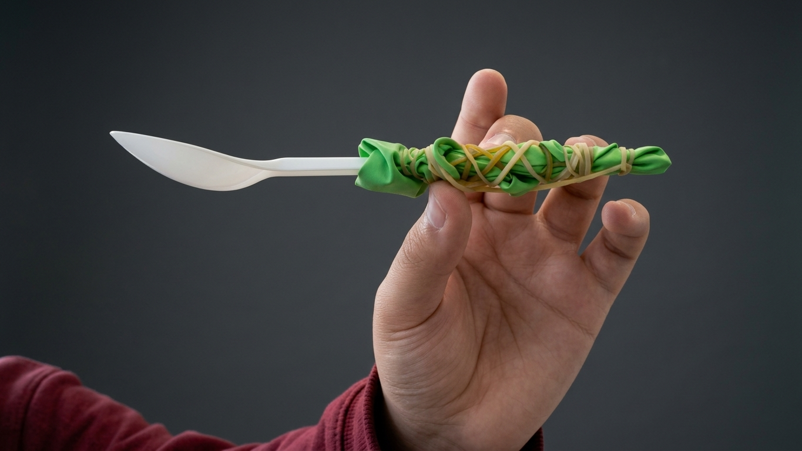

<!DOCTYPE html>
<html lang="en">
<head>
    <meta charset="UTF-8">
    <meta name="viewport" content="width=device-width, initial-scale=1.0">
    <title>Ergonomic Enhanced Spoon | Documentation</title>
    
</head>
<body>

    <header>
        <h1>🥄 Ergonomic Enhanced Spoon (EES)</h1>
        
Next-Generation 3D-Modelled Adaptive Cutlery

        
Created by <strong>E</strong> &amp; <strong>Z</strong>

    </header>

    

        <section>
            <h2>Overview</h2>
            
The Ergonomic Enhanced Spoon (EES) is an advanced adaptive utensil designed for ultimate grip stability, comfort, and precise balance. Built using precision CAD workflows and multi-layered grip mechanics, the product integrates a custom-contoured handle optimized for users requiring enhanced support.

        </section>

        <section>
            <h2>Key Product Features</h2>
            <ul>
                <li><strong>Ergonomic Contour Handle:</strong> Features a specialized molded grip body for a secure, anti-slip hold.</li>
                <li><strong>Balanced Weight Distribution:</strong> Engineered to reduce wrist fatigue and maximize control during usage.</li>
                <li><strong>Precision 3D Model:</strong> Fully optimized for 3D printing and manufacturing workflows.</li>
            </ul>
        </section>

        <section>
            <h2>Product &amp; 3D Gallery</h2>
            
Visual documentation showcasing the physical assembly, studio isolation, and 3D design iterations:

            
            

                <!-- Image 1 -->
                

                    
                    
Studio Isolated Render

                

                <!-- Image 2 -->
                

                    
                    
Hand Grip Ergonomics

                

                <!-- Video Showcase -->
                

                    <video autoplay loop muted playsinline>
                        <source src="tripo-showcase.mp4" type="video/mp4">
                        Your browser does not support the video tag.
                    </video>
                    
3D Model Turntable Showcase

                

            

        </section>
    

    <footer>
        
&copy; 2026 E &amp; Z. Hosted on GitHub Pages.

    </footer>

</body>
</html>
